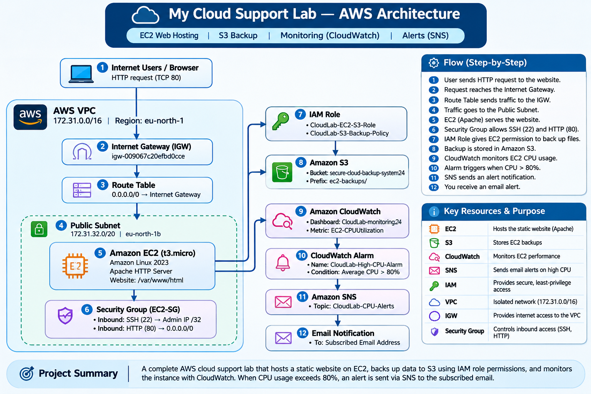
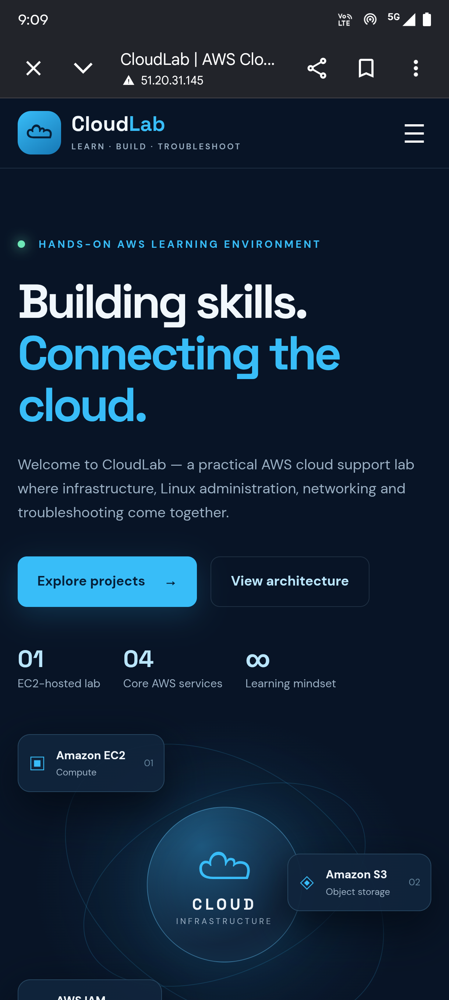

<!-- My Cloud Support Lab – AWS EC2 Project -->

## Project Overview

My Cloud Support Lab is a hands-on AWS project focused on learning and practising cloud infrastructure, EC2 instance management, networking, web server deployment, storage integration, and infrastructure monitoring.

In this project, I launched an Amazon EC2 instance, configured VPC networking and security settings, installed Apache HTTP Server, and deployed a responsive static website. I extended the lab by integrating Amazon S3 through an EC2 IAM role and configuring Amazon CloudWatch monitoring, a high-CPU alarm, and an Amazon SNS email notification action. The project provided practical experience with AWS infrastructure, Linux administration, access control, storage operations, monitoring, and troubleshooting.

## Project Architecture



The diagram shows the EC2 web-hosting environment and its integrations with Amazon S3 and Amazon CloudWatch. The S3 bucket is in `ap-south-1`, while the EC2 instance and CloudWatch resources are in `eu-north-1`.

## AWS Services and Technologies Used

- **Amazon EC2:** Hosted the website on a Linux virtual server.
- **Amazon VPC:** Provided the isolated network environment.
- **Internet Gateway:** Enabled internet connectivity for the public subnet.
- **Route Table:** Routed internet-bound traffic through the Internet Gateway.
- **Security Groups:** Controlled inbound traffic to the EC2 instance.
- **Network ACL:** Provided subnet-level network traffic filtering.
- **Amazon Linux 2023:** Operating system for the EC2 instance.
- **Apache HTTP Server:** Hosted the static website.
- **Amazon S3:** Stored backup test objects in a dedicated project prefix.
- **AWS IAM:** Provided an EC2 role with scoped permissions for S3 operations.
- **Amazon CloudWatch:** Displayed EC2 CPU metrics and evaluated alarm conditions.
- **Amazon SNS:** Delivered email notifications from the CloudWatch alarm.
- **HTML5, CSS3 and JavaScript:** Used to build the responsive website.
- **AWS CLI and Linux:** Used for server administration and S3 operations.

## Project Configuration

| Component | Configuration |
|---|---|
| EC2 Region | `eu-north-1` (Europe – Stockholm) |
| Availability Zone | `eu-north-1b` |
| Instance Type | `t3.micro` |
| Operating System | Amazon Linux 2023 |
| Web Server | Apache HTTP Server |
| HTTP Port | `80` |
| SSH Port | `22` |
| Web Root Directory | `/var/www/html` |
| VPC CIDR | `172.31.0.0/16` |
| Public Subnet CIDR | `172.31.32.0/20` |
| Internet Gateway | `igw-009067c20efbd0cce` |
| S3 Bucket | `secure-cloud-backup-system24` |
| S3 Bucket Region | `ap-south-1` |
| S3 Backup Prefix | `ec2-backups/` |
| EC2 IAM Role | `CloudLab-EC2-S3-Role` |
| IAM Policy | `CloudLab-S3-Backup-Policy` |
| CloudWatch Dashboard | `CloudLab-monitoring24` |
| CloudWatch Alarm | `CloudLab-High-CPU-Alarm` |
| CPU Alarm Threshold | Average `CPUUtilization` greater than `80%` |
| SNS Topic | `CloudLab-CPU-Alerts` |

## Implementation Steps

### 1. Launch EC2 Instance
- Launched a `t3.micro` EC2 instance.
- Selected Amazon Linux 2023.
- Configured the required network settings.

### 2. Configure Networking
- Used the existing VPC and public subnet.
- Verified the Internet Gateway attachment.
- Checked the route table and default internet route (`0.0.0.0/0`).
- Confirmed public IPv4 address assignment.

### 3. Configure Security Group
Configured inbound rules:

| Type | Port | Source |
|---|---:|---|
| SSH | `22` | My IP address (`/32`) |
| HTTP | `80` | `0.0.0.0/0` |

SSH access was restricted to the administrator's current public IP address. HTTP was allowed publicly so visitors could access the practice website.

### 4. Connect to EC2
- Connected using EC2 Instance Connect.
- Accessed the instance through the terminal.

### 5. Install Apache
- Updated the system packages.
- Installed Apache HTTP Server.
- Started and enabled the Apache service.
- Verified the service using `systemctl`.

Example commands:

```bash
sudo dnf update -y
sudo dnf install httpd -y
sudo systemctl start httpd
sudo systemctl enable httpd
sudo systemctl status httpd
```

### 6. Deploy Website
- Created the website using HTML, CSS, and JavaScript.
- Stored website files in `/var/www/html`.
- Accessed the website using the EC2 public IPv4 address.
- Tested the responsive website on desktop and mobile screens.

### 7. Configure EC2-to-S3 Access
- Created and attached the `CloudLab-EC2-S3-Role` IAM role to the EC2 instance.
- Attached the `CloudLab-S3-Backup-Policy` policy.
- Scoped S3 object access to the `ec2-backups/` project prefix.
- Used the EC2 role to upload and download a test object from S3.
- Verified the downloaded test file content.

S3 project location:

```text
s3://secure-cloud-backup-system24/ec2-backups/
```

The S3 bucket is in `ap-south-1`, separate from the EC2 region (`eu-north-1`). The EC2 instance accesses S3 through its IAM role; long-term AWS access keys are not stored on the instance. The bucket-list permission is restricted by an S3 prefix condition in the IAM policy.

### 8. Configure CloudWatch Monitoring and SNS Notifications
- Created the `CloudLab-monitoring24` CloudWatch dashboard.
- Added the EC2 `CPUUtilization` metric to the dashboard.
- Created the `CloudLab-High-CPU-Alarm` metric alarm.
- Configured the alarm to trigger when average CPU utilization is greater than `80%` for the configured evaluation period (one datapoint within five minutes).
- Created the `CloudLab-CPU-Alerts` SNS topic.
- Added an email subscription and confirmed it using the AWS confirmation email.
- Configured the SNS notification action for the alarm's **In alarm** state.
- Verified in the CloudWatch alarm's **Actions** tab that the notification action targets `CloudLab-CPU-Alerts` and that actions are enabled.

The alarm action sends a notification when the alarm transitions to the **In alarm** state. An alarm currently in **OK** state does not send an alert simply because it is OK.

## Project Screenshots

### Apache service running


### Instance successfully running


### SSH and HTTP rules


### Website successfully hosted


### Responsive website


### CloudWatch monitoring
Add the latest CloudWatch dashboard and alarm screenshots to the repository after collecting the final evidence. Suggested filenames:

- `cloudwatch-dashboard.png`
- `cloudwatch-alarm-actions.png`

## Challenges and Troubleshooting

During the project, I encountered and worked on resolving the following issues:

- Troubleshooting EC2 instance connectivity.
- Configuring SSH (port `22`) and HTTP (port `80`) security group rules.
- Understanding public IPv4 address connectivity.
- Verifying VPC route table and Internet Gateway configuration.
- Checking Apache HTTP Server status.
- Configuring an EC2 IAM role for scoped S3 access.
- Understanding S3 object permissions and prefix-restricted bucket listing.
- Verifying S3 uploads and downloads from the EC2 instance.
- Creating a CloudWatch CPU metric alarm and configuring its SNS notification action.

## Security Configuration

- Restricted SSH access through the EC2 security group to the administrator's current IP address (`/32`).
- Allowed HTTP traffic on port `80` for public website access.
- Used AWS security groups to manage instance-level inbound traffic.
- Used an EC2 IAM role instead of storing AWS access keys on the instance.
- Scoped S3 access to the project's backup prefix.
- Kept the SNS email endpoint private; no email address is published in this repository.
- Never committed private keys, credentials, or access-key CSV files.

## What I Learned

Through this hands-on project, I developed practical knowledge of:

- Launching and managing Amazon EC2 instances.
- Understanding VPCs, public subnets, route tables, Internet Gateways, security groups, and NACLs.
- Working with Amazon Linux 2023 and Linux commands.
- Installing and managing Apache HTTP Server.
- Hosting a responsive static website on an EC2 instance.
- Using IAM roles and least-privilege policies for EC2-to-S3 access.
- Uploading and downloading S3 objects using the AWS CLI.
- Monitoring EC2 CPU utilization with CloudWatch dashboards and alarms.
- Configuring SNS email notifications for CloudWatch alarm state changes.
- Troubleshooting cloud connectivity and permissions issues.

## Future Improvements

- Configure HTTPS using SSL/TLS.
- Add CloudWatch dashboard and alarm screenshots to the repository.
- Explore additional CloudWatch metrics, logs, and alarms.
- Automate backup operations and retention.
- Explore automated website deployment.

## Additional Configuration

Detailed networking, IAM, EC2, S3, and CloudWatch configuration notes are available in [aws-configuration](aws-configuration).

## Author

**Pankaj Dhavale**

Aspiring Cloud Engineer

This project is part of my hands-on AWS cloud learning journey.
