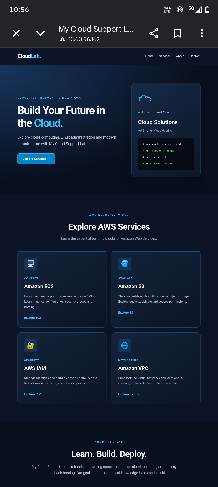

<!-- # My Cloud Support Lab – AWS EC2 Project -->

## Project Overview

My Cloud Support Lab is a hands-on AWS project focused on learning and practising cloud infrastructure, EC2 instance management, basic networking, and web server deployment.

In this project, I launched an Amazon EC2 instance, configured the required networking and security settings, installed and configured Apache HTTP Server, and deployed a responsive static website using HTML and CSS. This project helped me gain practical experience with AWS infrastructure and basic cloud troubleshooting.

## Project Architecture

## AWS Services and Technologies Used

- **Amazon EC2:** Hosted the website on a virtual server.
- **Amazon VPC:** Provided the isolated network environment.
- **Internet Gateway:** Enabled internet connectivity.
- **Security Groups:** Controlled inbound traffic to the EC2 instance.
- **Network ACL:** Provided subnet-level network traffic filtering.
- **Route Table:** Defined network traffic routing.
- **Amazon Linux 2023:** Operating system for the EC2 instance.
- **Apache HTTP Server:** Hosted the static website.
- **HTML5 and CSS3:** Used to build the website.

## Project Configuration

| Component | Configuration |
|---|---|
| AWS Region | eu-north-1 |
| Availability Zone | eu-north-1b |
| Instance Type | t3.micro |
| Operating System | Amazon Linux 2023 |
| Web Server | Apache HTTP Server |
| HTTP Port | 80 |
| SSH Port | 22 |
| Web Root Directory | /var/www/html |

## Implementation Steps

### 1. Launch EC2 Instance
- Launched a t3.micro EC2 instance.
- Selected Amazon Linux 2023.
- Configured the required network settings.

### 2. Configure Networking
- Used an existing VPC and public subnet.
- Verified the Internet Gateway.
- Checked the route table and internet route.
- Confirmed public IPv4 address assignment.

### 3. Configure Security Group
Configured inbound rules:

| Type | Port | Source |
|---|---:|---|
| SSH | 22 | My IP address |
| HTTP | 80 | 0.0.0.0/0 |

### 4. Connect to EC2
- Connected using EC2 Instance Connect.
- Accessed the instance through the terminal.

### 5. Install Apache
- Updated the system packages.
- Installed Apache HTTP Server.
- Started and verified the Apache service.

### 6. Deploy Website
- Created HTML and CSS files.
- Stored website files in `/var/www/html`.
- Accessed the website using the EC2 public IPv4 address.
- Tested the website on desktop and mobile screens.

## Project Screenshots

Add your screenshots below. Update the image filenames if yours are different.

###	Apache service running

### Instance successfully running

### SSH and HTTP rules

### Website successfully hosted

### Responsive website

## Challenges and Troubleshooting

During the project, I encountered and worked on resolving the following issues:

- Troubleshooting EC2 instance connectivity.
- Configuring SSH (Port 22) and HTTP (Port 80) security group rules.
- Understanding public IP address connectivity.
- Verifying VPC route table and Internet Gateway configuration.
- Checking Apache HTTP Server status.
- Testing website accessibility through the browser.

## Security Configuration

- Configured SSH access through the EC2 security group.
- Allowed HTTP traffic on Port 80 for public website access.
- Used AWS security groups to manage inbound traffic.
- Avoided exposing private keys and sensitive credentials.

## What I Learned

Through this hands-on project, I developed practical knowledge of:

- Launching and managing Amazon EC2 instances.
- Understanding basic AWS networking.
- Configuring security groups and inbound rules.
- Working with Amazon Linux 2023.
- Using Linux commands through the terminal.
- Installing and managing Apache HTTP Server.
- Hosting a static website on an EC2 instance.
- Troubleshooting basic cloud connectivity issues.

## Future Improvements

- Configure HTTPS using SSL/TLS.
- Learn and integrate Amazon S3.
- Implement IAM roles and permissions.
- Configure Amazon CloudWatch for monitoring.
- Explore automated deployment.

## Author

**Pankaj Dhavale**

Aspiring Cloud Engineer

This project is part of my hands-on AWS cloud learning journey.oud learning journey.
